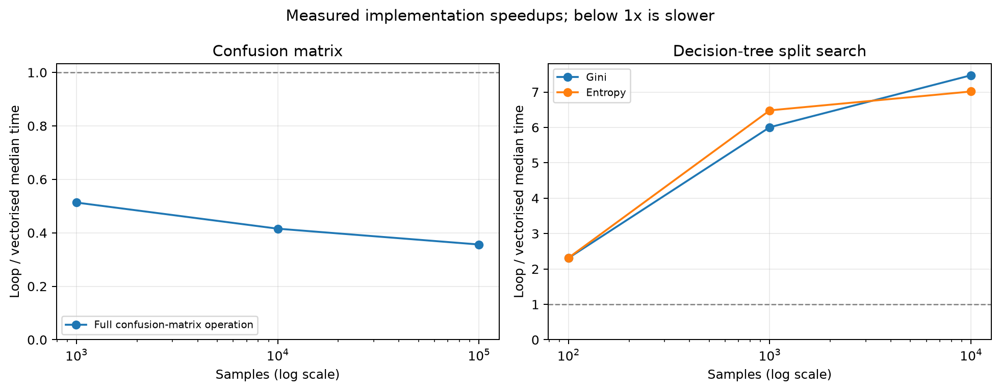
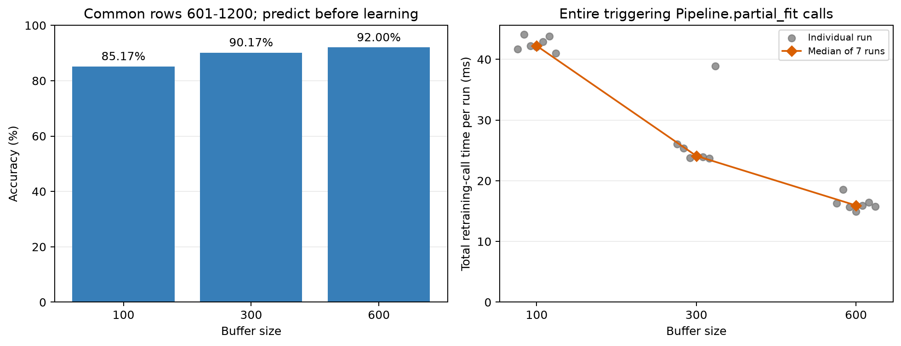
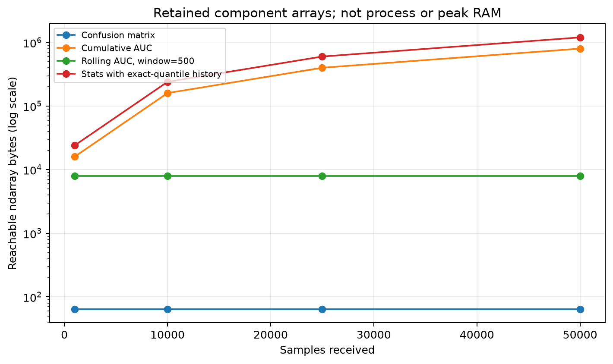

# Streaming benchmarks and long-stream checks

## Environment and source

Verified on Windows with Python 3.12.6, NumPy 2.5.5 and
Matplotlib 3.11.2.

Base commit: f66da3e805085539bd79d9e6000eee82beead521.
Branch: Jiahe-assignment-2.2.

The benchmark scripts and reference tests were uncommitted when these
experiments ran. Result metadata records the base commit, working-tree
status and source-file SHA256 hashes. The base commit alone does not
contain the experiment scripts.

## Reproduction

Run from the repository root with the project environment activated:

```powershell
python -W error -m unittest tests.stream.test_benchmark_confusion_reference tests.stream.test_benchmark_split_reference -v
python -W error -m benchmark.run_stream_vectorization
python -W error -m benchmark.run_stream_buffers
python -W error -m benchmark.check_stream_state_growth
python -W error -m benchmark.check_stream_long_run
```

Each experiment creates a new timestamped result directory.
The --quick option on the two timing scripts runs a smoke check;
smoke timings are not used as formal performance evidence.

## Loop versus vectorised implementations

Every timed case first checks output equivalence. Each implementation
is warmed once, then measured seven times with alternating execution
order. Reported times are medians; speedup is loop/vectorised time.
Data generation, correctness checks and result-file writing are excluded.

Confusion-matrix comparison includes the complete batch loop function
versus fresh StreamingConfusionMatrix construction, one update and
result retrieval. This is not an isolated bincount benchmark.

Split-search comparison includes validation, sorting and evaluation of
all features. Both implementations sort and accumulate class counts;
the loop reference evaluates candidates using scalar Python operations.
Training partitions are compared because the reference returns an
observed boundary and production uses a midpoint threshold.

| Operation | Samples | Loop median (s) | Vectorised median (s) | Speedup |
|---|---:|---:|---:|---:|
| Confusion matrix | 1,000 | 0.000299 | 0.000583 | 0.513x |
| Confusion matrix | 10,000 | 0.002234 | 0.005378 | 0.416x |
| Confusion matrix | 100,000 | 0.024309 | 0.068215 | 0.356x |
| Split search, Gini | 100 | 0.000999 | 0.000433 | 2.309x |
| Split search, Gini | 1,000 | 0.010903 | 0.001816 | 6.005x |
| Split search, Gini | 10,000 | 0.110149 | 0.014740 | 7.473x |
| Split search, entropy | 100 | 0.001052 | 0.000454 | 2.316x |
| Split search, entropy | 1,000 | 0.010933 | 0.001687 | 6.481x |
| Split search, entropy | 10,000 | 0.112386 | 0.016021 | 7.015x |

Values above are rounded terminal output; raw JSON retains higher precision.
All nine equivalence checks passed.

Split search accelerated on these inputs. The complete streaming
confusion-matrix path was slower than the batch loop reference at all
measured sizes. These measurements do not isolate the cause and do not
establish that vectorisation always improves performance.

Results:
benchmark/results/stream_vectorization_formal_20261116T104755_980073Z/

## Buffer-size comparison

Dataset: demo/data/stream_classification.csv.

SHA256:
38451bd12d42d19fd1aa2214a3688d5fc379acec86853519719c7fe642f27e08

The dataset contains 1,200 rows, three features, class counts [517, 683]
and 154 missing feature values. Original row order is preserved.

Fixed configuration:

- Chunk size: 50.
- Imputer(mean) -> StandardScaler -> DecisionTreeClassifier.
- Tree: max_depth=5, min_samples_split=2, max_features=None,
  criterion=gini, random_state=2026.
- Predict before learning each chunk.
- Common evaluation interval: original data rows 601-1200.
- One disposable warm-up run per configuration, then seven fresh-model
  runs per configuration, with rotated configuration order.

| Buffer | Evaluated rows | Own-interval accuracy | Common accuracy | Retrains | Median total retrain-call time (s) |
|---|---:|---:|---:|---:|---:|
| 100 | 1,100 | 0.865455 | 0.851667 | 12 | 0.042229300 |
| 300 | 900 | 0.905556 | 0.901667 | 4 | 0.024096200 |
| 600 | 600 | 0.920000 | 0.920000 | 2 | 0.015937600 |

Time medians above were calculated directly from raw run records and
are displayed to nine decimal places. Accuracy values are rounded.
The derived buffer_summary.csv retains the calculated aggregates.

Retrain-call time measures the entire triggering Pipeline.partial_fit
call, including validation, buffering, preprocessing reconstruction,
tree fitting and publication. It is not isolated tree-fit time.
The table takes the median across seven per-run totals, not the median
duration of an individual retraining event.

Historical predictions and event structure reproduced across all seven
runs of each configuration. Each retraining used its configured buffer
size, and all three configurations ended with empty buffers.

Common-interval accuracy is the primary fair accuracy comparison.
Learning continues during this interval: this is prequential evaluation,
not a fixed held-out test. Buffer 600 performed best on this dataset,
but also required longer warm-up and retrained less frequently.
This does not establish an optimal buffer size for other streams.
The slower seventh run for buffer 300 remains in the raw results.

Results:
benchmark/results/stream_buffers_formal_20261116T110038_916524Z/

## Retained-state growth

A separate synthetic stream generated 50,000 rows in chunks of 100,
with three finite features, two fixed classes and a rolling window of 500.

| Samples | Confusion bytes | Cumulative AUC bytes | Rolling AUC bytes | Stats bytes |
|---|---:|---:|---:|---:|
| 1,000 | 64 | 16,000 | 8,000 | 24,072 |
| 10,000 | 64 | 160,000 | 8,000 | 240,072 |
| 25,000 | 64 | 400,000 | 8,000 | 600,072 |
| 50,000 | 64 | 800,000 | 8,000 | 1,200,072 |

Counts, retained window sizes, finite AUC results and the final exact
median query passed their checks. Fixed-class confusion storage and
rolling AUC storage remained stable at these checkpoints. Cumulative
AUC and exact-quantile history grew with input.

These are logical bytes of reachable ndarray objects, not process RAM
or peak memory. Python overhead, object-array referents, temporary
allocations and external input/output records are excluded.

Results:
benchmark/results/stream_state_growth_20261116T110353_331858Z/

## Longer integrated stream and invalid-input recovery

A separately generated stream exercised Pipeline and StreamTrainer
with missing values, cumulative and rolling AUC, chunk size 100,
buffer size 300 and a final short chunk of 37 rows.

Verified final state:

- 20,037 input rows and 201 successful score/fit pairs.
- 300 warm-up rows; 19,737 evaluated rows.
- 66 retrainings, each using 300 rows.
- 237 rows retained in the final buffer; no automatic flush.
- 403 log events: 402 normal events and one rejected fit attempt.
- 340,280 reachable model/evaluation array bytes at the final checkpoint.

After 10,000 valid rows, one scoring call and one training call containing
Inf were rejected. Model state, evaluation counters/metrics and probe
predictions were unchanged. Failed scoring produced no log event;
failed training produced one failure record. Valid processing continued
successfully afterward.

This checks input-validation failure recovery, not an injected failure
inside tree construction. Logs grow with event count, and enabled
cumulative AUC retains history. The integrated framework is not
constant-memory.

Results:
benchmark/results/stream_long_run_20261116T110952_735693Z/

## Test evidence

- Reference comparison modules: 11 tests passed, 0.285 s.
- Streaming suite with warnings treated as errors:
  406 tests passed, 1.409 s.
- Full regression: 903 tests passed, 1.680 s
  (497 original tests and 406 streaming tests).

The long-stream scripts are additional executable checks, not additional
unittest cases. Their assertions do not increase the reported test count.

## Result figures

Generate figures from the recorded formal results:

```powershell
python -W error -m benchmark.plot_stream_results
```

The plotting script references the exact result directories documented
above. It does not rerun benchmarks or automatically select newer results.
To plot another experiment, explicitly update its source paths.

The output directory is benchmark/results/stream_summary_figures/.
Repeated plotting overwrites these derived files while preserving
the source experiment records.

### Implementation speedups



The dashed line marks 1x. Values below it indicate that the complete
vectorised path was slower than its loop reference.

### Buffer comparison



Accuracy uses the same 600 prequentially evaluated rows for each model.
Timing points show all seven runs, including the slower buffer-300 run;
diamonds show medians of per-run total Pipeline retraining-call times.

### Retained array storage



The vertical axis is logarithmic. Values describe reachable ndarray
storage, not process RAM or temporary peak allocations.

### Derived data and provenance

- [Buffer aggregates](../benchmark/results/stream_summary_figures/buffer_summary.csv)
- [Figure source paths and SHA256 hashes](../benchmark/results/stream_summary_figures/sources.json)

All three PNG files passed nonempty-file and PNG-signature checks.
Visual inspection confirmed readable titles, axes and legends.